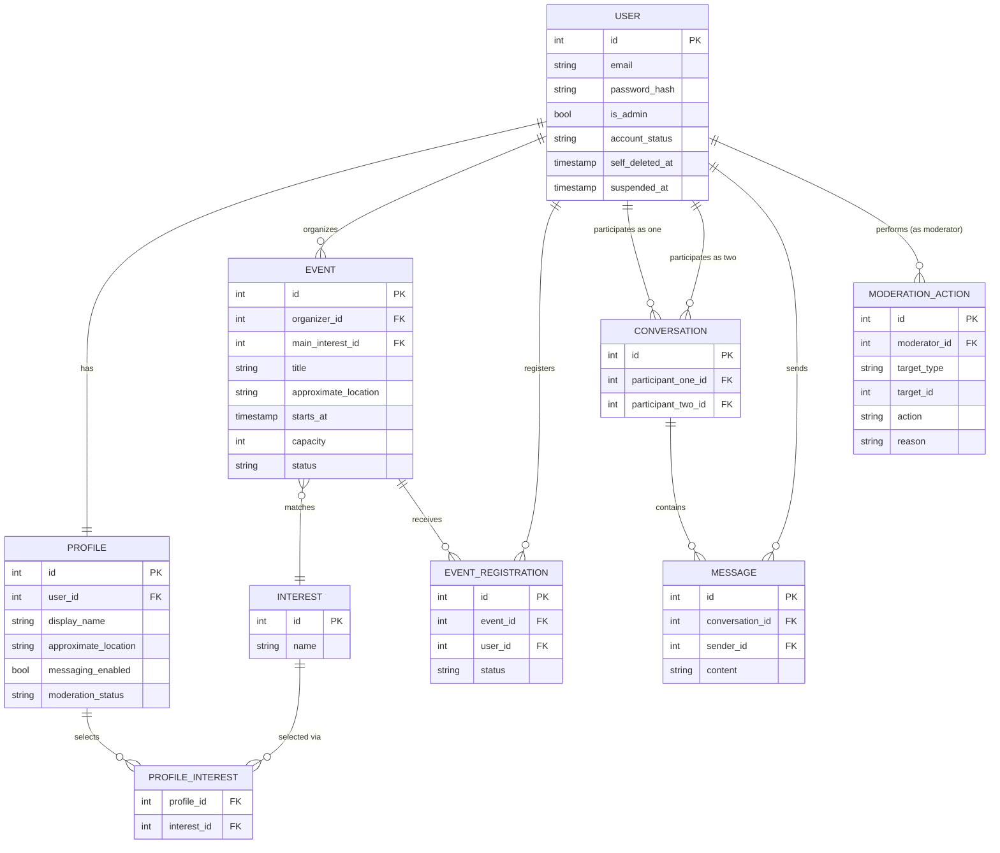

# Re-Tired Hearts — Data Model

Phase 0 deliverable covering issues:
- **#20** — Design entities: `User`, `Profile`, `Interest`, `ProfileInterest`, `Event`, `EventRegistration`, `Conversation`, `Message`, `ModerationAction`.
- **#21** — Database diagram (relationships, cardinalities, PKs, FKs). Reused in the Phase 6 presentation.
- **#23** — Soft-delete vs hard-delete policy for `User` (+ cascades).

This is a draft for team review before the Phase 1 migrations (issue #47/#57/etc.) implement it.

## 1. Entities (#20)

### User
| Field | Type | Notes |
|---|---|---|
| `id` | PK | |
| `email` | unique, not null | |
| `password_hash` | not null | never stored/returned in plaintext |
| `is_admin` | bool, default `false` | moderator permissions — never self-assignable; see "Roles" below |
| `account_status` | enum: `active`, `self_deleted`, `suspended` | default `active`; the two soft-delete causes (self vs. moderator) are distinct enum values, not inferred — see §3 |
| `self_deleted_at` | nullable timestamp | set when the user deletes their own account (`account_status` → `self_deleted`) |
| `suspended_at` | nullable timestamp | set when a moderator suspends the account (`account_status` → `suspended`) |
| `created_at` | timestamp | |

**Roles.** The brief's three-tier role (`member`/`organizer`/`moderator`) is collapsed to a single `is_admin` boolean:
- `is_admin = true` → moderator permissions: approve/block/unblock profiles, suspend/reactivate accounts, cancel events. Grounded in `docs/requirements.md:70` ("Document role-assignment rules: member/organizer/moderator... Moderator role does not auto-grant event-creation rights."), `docs/requirements.md:96` ("distinguish member/organizer/moderator permissions... Organizer/moderator only via controlled process... never via public registration or profile edit"), `docs/requirements.md:156` ("implement protected moderation routes... approve pending profiles, block approved profiles, unblock blocked profiles..., suspend/reactivate accounts, cancel inappropriate events. Only authorized moderators."), and `docs/requirements.md:162` ("Prevent self-modification of own role/moderation status/account restriction via manipulated requests.").
- `is_admin = false` (default) → ordinary member. Never self-assignable; only flipped via the same controlled/seed process the brief requires for moderator grants (`docs/requirements.md:96`).
- **Organizer is dropped as a stored role.** It isn't a permission tier distinct from member — it's simply "the user referenced by a given `Event.organizer_id`." Any member with an approved profile may create an event and becomes its organizer purely by that FK; the brief's "organizers keep standard member permissions, can register for others' events, not their own" (`docs/requirements.md:70`) and "enforce organizer ownership" (`docs/requirements.md:125`) only require an event-scoped ownership check (`event.organizer_id == current_user.id`), not a sitewide role field.
  - **Flag for the team:** this is a looser reading than `docs/requirements.md:96` ("Organizer/moderator only via controlled process... never via public registration") and `docs/requirements.md:124` ("creating an event requires approved profile + organizer role"), which imply organizer is also admin-granted like moderator. Confirm before Phase 2 migrations (#47/#48) lock in "any approved member can organize."

### Profile
| Field | Type | Notes |
|---|---|---|
| `id` | PK | |
| `user_id` | FK → User, unique | 1:1 with User |
| `display_name` | not null | |
| `bio` | nullable text | |
| `approximate_location` | e.g. city/region | never exact address |
| `messaging_enabled` | bool, default true | privacy choice |
| `moderation_status` | enum: `pending`, `approved`, `blocked` | default `pending`; not discoverable until `approved` |
| `created_at` / `updated_at` | timestamp | |

### Interest
| Field | Type | Notes |
|---|---|---|
| `id` | PK | |
| `name` | unique, not null | |

### ProfileInterest (join table)
| Field | Type | Notes |
|---|---|---|
| `profile_id` | FK → Profile | composite PK |
| `interest_id` | FK → Interest | composite PK |

M:N between Profile and Interest (a member's selected interests).

### Event
| Field | Type | Notes |
|---|---|---|
| `id` | PK | |
| `organizer_id` | FK → User | the creator; requires an approved profile, no separate role (see "Roles" under User) |
| `main_interest_id` | FK → Interest, not null | **exactly one** main interest — enables filter-by-interest |
| `title` / `description` | | |
| `approximate_location` | | never exact address |
| `starts_at` | timestamp | |
| `capacity` | int | |
| `status` | enum: `draft`, `published`, `cancelled`, `completed` | |
| `created_at` / `updated_at` | timestamp | |

### EventRegistration
| Field | Type | Notes |
|---|---|---|
| `id` | PK | |
| `event_id` | FK → Event | |
| `user_id` | FK → User | |
| `status` | enum: `registered`, `withdrawn` | only `registered` counts toward capacity |
| `created_at` / `updated_at` | timestamp | |
| — | unique `(event_id, user_id)` | withdraw/re-register reuses the row, no duplicates |

### Conversation
| Field | Type | Notes |
|---|---|---|
| `id` | PK | |
| `participant_one_id` | FK → User | |
| `participant_two_id` | FK → User | |
| `created_at` | timestamp | |
| — | unique on the unordered pair | prevents duplicate conversations regardless of initiator (e.g. normalize so `participant_one_id < participant_two_id`) |

Exactly two distinct participants per conversation, enforced at the application layer (eligibility rule in a separate issue) and a DB unique constraint on the pair.

### Message
| Field | Type | Notes |
|---|---|---|
| `id` | PK | |
| `conversation_id` | FK → Conversation | |
| `sender_id` | FK → User | always derived from the authenticated session, never client-supplied |
| `content` | text, 1–1000 chars | plain text only, no executable HTML |
| `created_at` | timestamp | |

### ModerationAction
| Field | Type | Notes |
|---|---|---|
| `id` | PK | |
| `moderator_id` | FK → User | |
| `target_type` | enum: `profile`, `user_account`, `event` | polymorphic target |
| `target_id` | int, not null | id within `target_type`'s table (no single FK — target type varies) |
| `action` | enum: `approve_profile`, `block_profile`, `unblock_profile`, `suspend_account`, `reactivate_account`, `cancel_event` | |
| `reason` | nullable text | **never** passwords or private message content |
| `created_at` | timestamp | |

## 2. Diagram (#21)

GitHub renders this Mermaid block natively, so it stays reviewable in the PR diff and is reusable as-is for the Phase 6 presentation (issue #84).

## 3. Soft-delete vs hard-delete policy for `User` (#23)

**Decision: soft-delete only, via two distinct, mutually exclusive `account_status` values — `self_deleted` (user-triggered) and `suspended` (moderator-triggered). `User` rows are never hard-deleted.**

Both are "inactive" states that exclude the account from authentication, discovery, and registration eligibility (one check everywhere: `account_status != 'active'`), and both keep the row so every FK pointing at it (`Profile.user_id`, `Event.organizer_id`, `EventRegistration.user_id`, `Conversation.participant_*_id`, `Message.sender_id`, `ModerationAction.moderator_id`) stays valid. What differs is *who* can trigger each one and whether it's reversible:

| | `self_deleted` | `suspended` |
|---|---|---|
| Triggered by | the account owner, via their own "delete my account" action | a moderator (`is_admin = true`), via a protected moderation route (`docs/requirements.md:156`) |
| Timestamp | `self_deleted_at` | `suspended_at` |
| `ModerationAction` row written | none — no moderator was involved | yes, `action = 'suspend_account'`, `moderator_id` = the acting moderator |
| Reversible? | no — terminal for this phase (no self-service "undelete"; flag as a future issue if the team wants a grace-period restore) | yes — `action = 'reactivate_account'` moves it back to `active` |

This replaces an earlier draft of this section that reused `suspended` for both causes and distinguished them only by inferring intent from whether a `ModerationAction` row happened to exist — fragile, and flagged as a pre-migration risk. Making the cause part of the enum itself means every query/report can filter or group by `account_status` directly, with no join or inference needed, and a moderator can never accidentally "reactivate" a self-deletion (the `reactivate_account` action is only meaningful against `suspended`).

**Why not hard-delete:** several requirements explicitly depend on history surviving a user's departure —
- Published events with registrations must be cancelled, not deleted, and existing registrants must still see them (issue #48 acceptance bar). If the organizer were hard-deleted, `Event.organizer_id` would dangle or cascade-delete the event.
- Conversations/messages must remain readable to the counterpart after a participant loses access (issue #58's eligibility rule: "existing history access still follows account/privacy rules"). Hard-deleting the user would either orphan `Message.sender_id` or cascade-delete message history the other participant is still entitled to see.
- `ModerationAction` is an audit trail and must stay intact regardless of what later happens to the moderator or the target account.

**Cascade behavior when a `User` becomes `self_deleted` or `suspended`:**
| Dependent entity | Effect |
|---|---|
| `Profile` | Treated as not discoverable (same effect as `blocked`), but the row is kept, not deleted. |
| `EventRegistration` | Rows with `status = 'registered'` are flipped to `withdrawn`, freeing capacity; rows are kept. |
| `Event` (as organizer) | Event rows are **not** touched; UI/API render the organizer as a generic "unavailable user" rather than exposing account details. |
| `Conversation` / `Message` | Untouched. New messages from/to the inactive user are refused (same mechanism as a disabled-messaging account); existing history remains visible to the other participant. |
| `ModerationAction` | Never touched — the audit trail is immutable regardless of account state. |

Cascade behavior is identical for both causes; only the triggering actor, the timestamp column, and reversibility differ. **Open question for the team:** can a moderator still act (e.g. `suspend_account`) against an already-`self_deleted` row — for example if the account needs to be locked down for an investigation after the user deleted it? Not required by the current brief; flag before Phase 1 migrations (#38, #40) lock the state machine down.

This is a team decision (per `docs/requirements.md`'s decision table) — open for discussion before issue #57 (conversations/messages migrations) and #47 (events migrations) build on it.
