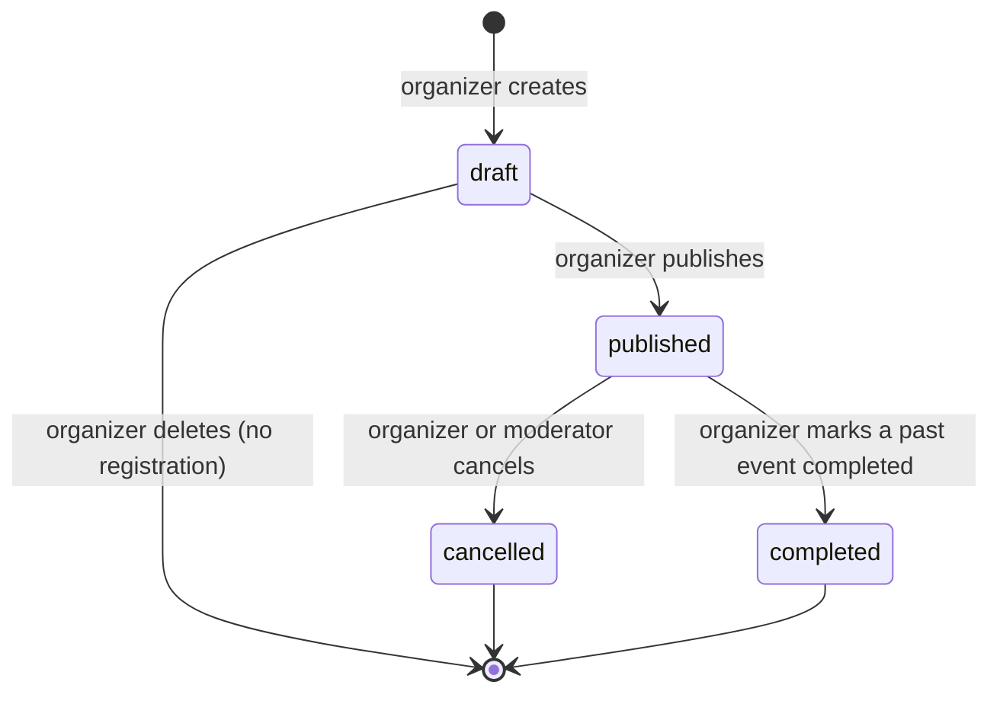

# Event rules: capacity and lifecycle

Phase 0 deliverable covering issue **#25**. Entities are defined in `docs/data-model.md`;
this page fixes the business rules the event routes (Phase 2) must follow.

## Vocabulary

- **Organizer**: the user referenced by `events.organizer_id`. Any member with an approved profile can create an event
  (there is no stored organizer role, see `docs/data-model.md`).
- **Moderator**: a user with `is_admin = true`.
- **Registered count**: number of `event_registrations` rows of the event with `status = 'registered'`.
  Withdrawn rows never count.
- **Available places** = `capacity` − registered count.

## Lifecycle states

| State | Meaning | Visible to | Registration |
|---|---|---|---|
| `draft` | being prepared | its organizer and moderators only | never |
| `published` | open to members | all authenticated members | only if the event is in the future and has a free place |
| `cancelled` | called off | registered participants, organizer, moderators (status clearly displayed) | never |
| `completed` | took place | registered participants, organizer, moderators (status clearly displayed) | never |

`cancelled` and `completed` are final: the event can no longer be edited, and nothing returns to `published`.
Completion is manual (no scheduler): a published event whose `starts_at` has passed stays `published` until its organizer
marks it `completed`, but it already refuses new registrations because it is in the past.

## Who can do what

| Action | Allowed for | Condition |
|---|---|---|
| Create (as draft) | active account with an approved profile | |
| Edit | organizer | state `draft` or `published`; capacity ≥ registered count; `starts_at` stays in the future |
| Publish | organizer | state `draft` |
| Cancel | organizer (`POST /v1/events/:id/cancel`), or moderator through `POST /v1/moderation/events/:id/cancel` only | state `published`; the moderation route always writes a `moderation_actions` row |
| Complete | organizer | state `published` and `starts_at` in the past |
| Delete (physical) | organizer | state `draft` and zero registrations, otherwise cancel instead |
| View a draft | organizer, moderator | |

A moderator has no general edit power over events: it can view drafts and cancel an event only through the audited moderation route (decision recorded in `docs/api-conventions.md`).

## Capacity rules

- `capacity` is an integer ≥ 1 (also enforced by a `CHECK` in the database).
- An organizer cannot lower the capacity below the current registered count (409).
- A member can **register** only if all of these hold:
  1. the event is `published` and `starts_at` is in the future;
  2. there is at least one available place;
  3. the account is `active` and the profile is `approved`;
  4. the member is not the organizer of that event;
  5. the member has no `registered` row for this event yet.
- **Withdraw**: the member's row goes from `registered` to `withdrawn`; the place is freed. The row is kept.
- Withdrawing is allowed only while the event is `published`; on a `cancelled` or `completed` event the registration is kept as it is.
- **Register again**: the same row goes back to `registered` if the conditions above still hold (no second row:
  `UNIQUE (event_id, user_id)`).
- When an event is cancelled, its registrations are left as they are, to keep the history readable for participants.
- When an account becomes `self_deleted` or `suspended`, its `registered` rows are switched to `withdrawn` (see `docs/data-model.md`).

## Concurrent registrations

The capacity check and the write must be atomic, otherwise two simultaneous requests could both see one free place.
Registration therefore runs in **one transaction** that first locks the event row (`SELECT ... FOR UPDATE`, TypeORM
`pessimistic_write`), then counts the `registered` rows, then inserts or reactivates the registration. A second request for
the same event waits for the lock and then sees the updated count.

## Error cases

| Situation | Response |
|---|---|
| Event is full, not published, already started, or already registered | 409 Conflict, explicit message |
| Organizer tries to register for their own event | 403 Forbidden |
| Capacity set below the registered count, or edit of a cancelled/completed event | 409 Conflict |
| Draft event requested by someone who is neither organizer nor moderator | 404 Not Found (its existence is not revealed) |
| Not the organizer on edit, publish, complete or delete | 403 Forbidden |
| Account suspended or profile not approved | 403 Forbidden |
| Withdraw from a `cancelled` or `completed` event, or without a `registered` row | 409 Conflict |

## Points to confirm with the team

- Whether the moderator account may register for events like a member.
- Whether a member who withdrew can still view the event once it is `cancelled` or `completed` (proposal: yes, any registration row gives access).
